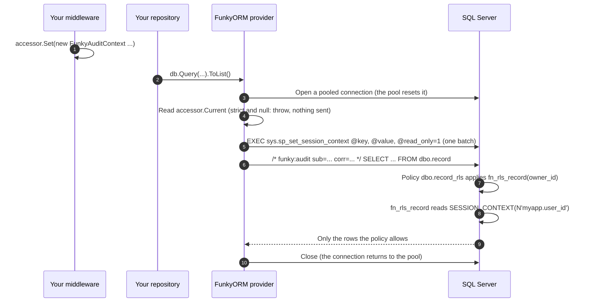

# Per-Request Session Context: Row-Level Security & Audit Attribution (v3.8.0+)

A how-to / runbook for attaching the **end-user's identity** to every database command FunkyORM sends,
even when your application authenticates to the database as a single identity (a managed identity, a
service account, a shared login). Two things become possible:

- **Row-Level Security (RLS) filtering**: a security policy in your database filters rows by the current user.
- **Audit attribution**: your audit trail (e.g. Azure SQL Auditing) names the person, not the shared
  identity.

> **Why FunkyORM has to do this.** Database session context is **per-connection** and is cleared when the
> pool resets the connection for its next use. FunkyORM uses a fresh pooled connection for each
> non-transactional operation, so "set the context once per request" outside the ORM does not survive onto
> the connection your query actually runs on. FunkyORM primes the context onto the *same* connection the
> command is about to use.

For a non-technical summary for decision makers, see the
[executive overview (PDF)](AUDIT_CONTEXT_EXECUTIVE_OVERVIEW.pdf).

**What this guide answers, in order:**

1. [What FunkyORM provides](#1-what-funkyorm-provides)
2. [What you add](#2-what-you-add)
3. [Wiring it up (SQL Server, ASP.NET Core)](#3-wiring-it-up-sql-server-aspnet-core)
4. [What happens at runtime](#4-what-happens-at-runtime)

PostgreSQL, MySQL and SQLite differences, the audit comment, security notes and troubleshooting follow.

---

## Capability by provider

| Provider | RLS filtering | Audit attribution | Per-key immutability |
|:--|:--|:--|:--|
| **SQL Server** | ✅ `SESSION_CONTEXT(key)` | ✅ | ✅ (`@read_only=1`) |
| **PostgreSQL** | ✅ `current_setting(key)` | ✅ | ⚠️ not enforced (no read-only GUC) |
| **MySQL** | ❌ (no native RLS) | ✅ (session vars) | ❌ not enforced |
| **SQLite** | ❌ N/A | ❌ N/A | — |

If you point a **strict** (audit-required) provider at SQLite, FunkyORM throws on first use. There is
no isolation model to enforce, so silently doing nothing would be unsafe for a PHI configuration.

---

## 1. What FunkyORM provides

Everything below ships in the `Funcular.Data.Orm` NuGet package. The audit types are in the
`Funcular.Data.Orm` namespace; the provider classes that carry the `AuditContext` property are in
`Funcular.Data.Orm.SqlServer`, `.PostgreSql`, `.MySql` and `.Sqlite`.
**None of it is a base class; you inherit from nothing.** There is one interface you implement and three
sealed classes you construct; the rest is behaviour.

| Type or member | Kind | What you do with it |
|:--|:--|:--|
| `IAuditContextAccessor` | Interface, one member: `FunkyAuditContext? Current { get; }` | **Implement it.** It is the only seam where your code plugs in. FunkyORM reads `Current` whenever it primes a connection or builds a command. Return `null` when nobody is signed in. |
| `FunkyAuditContext` | Sealed class: `Entries`, `AuditSubjectId`, `AuditCorrelationId` | **Construct one per request**, usually in authentication middleware. |
| `SessionContextEntry` | Sealed class: `new SessionContextEntry(string key, string value, bool readOnly = true)` | **Construct one per key** your database policy or audit logic will read. The value is an opaque string to FunkyORM; key rules differ by provider (see [PostgreSQL](#postgresql) and [MySQL](#mysql--sqlite)). `null` throws. |
| `AuditContextOptions` | Sealed class: `Accessor`, `RequireAuditContext` (default `false`), `EmitAuditComment` (default `true`) | **Construct one per provider** and assign it to the provider's `AuditContext` property. |
| `AuditContext` | Property on every provider (`SqlServerOrmDataProvider`, `PostgreSqlOrmDataProvider`, `MySqlOrmDataProvider`, `SqliteOrmDataProvider`) | **Set it** where you create providers. Its default is an `AuditContextOptions` with no accessor, which means the feature is off. |
| `SystemContextScope` | Sealed class, public | FunkyORM wraps its own bootstrap queries in it. You normally never touch it (see [Security notes](#security-notes-read-before-production)). |

Once a provider's `AuditContext.Accessor` is set, FunkyORM does five things for you:

1. **Primes every connection it uses.** Before the first command of an operation, on the connection that
   operation will run on, FunkyORM sends your entries in one parameterized batch (one round trip). The
   connection of a transaction started with `provider.BeginTransaction()` is primed once, when the
   transaction begins. A transaction it didn't begin (passed to the constructor, or assigned to
   `Transaction`) is primed once, by its first operation that has a context, with one extra command to
   read the keys first (3.13.0; see security note 6).
2. **Fails closed when told to.** With `RequireAuditContext = true` and `Current == null`, FunkyORM throws
   `InvalidOperationException` before sending your command. Once a transaction is primed, later operations
   in it aren't checked again.
3. **Labels each statement.** With `EmitAuditComment = true`, FunkyORM prepends
   `/* funky:audit sub=… corr=… */` to each text command, after validating both identifiers.
4. **Exempts its own bootstrap queries.** Schema discovery and table-name resolution run without
   priming, without the comment and without fail-closed, so they never fail for lack of a signed-in user.
5. **Changes nothing while the feature is off.** No accessor means no extra round trip and no comment.

What FunkyORM does **not** provide:

- an accessor implementation, middleware, or a DI registration helper;
- any RLS function, security policy, migration or DDL;
- your database's audit configuration.

FunkyORM reads the keys back only on a transaction it didn't begin, to avoid setting them twice (security
note 6). **It never calls your RLS function.** The database does that (see
[What happens at runtime](#4-what-happens-at-runtime)).

---

## 2. What you add

| # | You add | Where it lives | Name used in this guide (yours to change) |
|:--|:--|:--|:--|
| 1 | A class that implements `IAuditContextAccessor` | Application code | `AsyncLocalAuditContextAccessor` |
| 2 | Its DI registration, as a singleton | `Program.cs` | — |
| 3 | Middleware that builds a `FunkyAuditContext` after sign-in | Application code | an inline `app.Use(...)` |
| 4 | A factory that creates providers with `AuditContext` set | Application code | `OrmProviderFactory` |
| 5 | An RLS predicate function and a security policy | The database, as a migration or a DBA script | `dbo.fn_rls_record`, `dbo.record_rls` |
| 6 | Database auditing | The database or its cloud settings | Azure SQL Auditing, SQL Server Audit |

**The key names are the contract.** The only thing connecting your C# (item 3) to your SQL (item 5) is
the key string: the `SessionContextEntry` key you prime in middleware and the `SESSION_CONTEXT(N'…')` your
predicate reads must match exactly. This guide uses `myapp.user_id` and `myapp.group_ids` as placeholders;
choose your own namespace and names.

---

## 3. Wiring it up (SQL Server, ASP.NET Core)

### Step 1. Implement the accessor over your own `AsyncLocal`

```csharp
using Funcular.Data.Orm;

public sealed class AsyncLocalAuditContextAccessor : IAuditContextAccessor
{
    private static readonly AsyncLocal<FunkyAuditContext?> _ctx = new();
    public FunkyAuditContext? Current => _ctx.Value;      // FunkyORM calls this
    public void Set(FunkyAuditContext ctx) => _ctx.Value = ctx;   // your middleware calls this
}
```

`AsyncLocal` gives each request its own value, so parallel requests for different users never see each
other's context.

### Step 2. Register the accessor and the factory (singletons)

```csharp
services.AddSingleton<AsyncLocalAuditContextAccessor>();
services.AddSingleton<IAuditContextAccessor>(sp => sp.GetRequiredService<AsyncLocalAuditContextAccessor>());
services.AddSingleton<OrmProviderFactory>();   // Step 4
services.AddScoped<RecordRepository>();        // Step 4's example repository
```

### Step 3. Set the context per request, in middleware (after authentication)

```csharp
app.UseAuthentication();
app.Use(async (ctx, next) =>
{
    var accessor = ctx.RequestServices.GetRequiredService<AsyncLocalAuditContextAccessor>();
    if (ctx.User.Identity?.IsAuthenticated == true)
    {
        // Pull opaque identifiers from your authenticated principal, never a name/email/UPN.
        // Use your auth scheme's subject-id claim type; SessionContextEntry throws on a null value.
        var userId   = ctx.User.FindFirst("sub")?.Value
                       ?? throw new InvalidOperationException("No subject id claim.");
        var groupIds = ctx.User.FindAll("groups").Select(c => c.Value);  // opaque group/role keys

        accessor.Set(new FunkyAuditContext
        {
            Entries = new[]
            {
                new SessionContextEntry("myapp.user_id",   userId),                     // read_only by default
                new SessionContextEntry("myapp.group_ids", string.Join(",", groupIds)), // CSV, split with STRING_SPLIT
                new SessionContextEntry("myapp.request_id", ctx.TraceIdentifier),
            },
            AuditSubjectId     = userId,             // opaque id only, NO name/email/PII
            AuditCorrelationId = ctx.TraceIdentifier,
        });
    }
    await next();
});
```

Nothing touches the database here. The context sits in the `AsyncLocal` until FunkyORM opens a connection.

### Step 4. Create providers with `AuditContext` set (your ORM factory)

Give **PHI** repositories a strict provider; give non-PHI paths (app settings, health checks) a lenient
one:

```csharp
using Funcular.Data.Orm;
using Funcular.Data.Orm.SqlServer;

public sealed class OrmProviderFactory
{
    private readonly string _connectionString;
    private readonly IAuditContextAccessor _accessor;

    public OrmProviderFactory(IConfiguration config, IAuditContextAccessor accessor)
    {
        _connectionString = config.GetConnectionString("App")!;
        _accessor = accessor;
    }

    // PHI repositories: throw when nobody is signed in.
    public SqlServerOrmDataProvider CreateStrict() => Create(requireAuditContext: true);

    // Non-PHI paths: prime when a context exists, otherwise run without one.
    public SqlServerOrmDataProvider CreateLenient() => Create(requireAuditContext: false);

    private SqlServerOrmDataProvider Create(bool requireAuditContext) =>
        new SqlServerOrmDataProvider(_connectionString)
        {
            AuditContext = new AuditContextOptions
            {
                Accessor            = _accessor,
                RequireAuditContext = requireAuditContext,
                EmitAuditComment    = true,   // the default, shown for clarity
            },
        };
}
```

A repository then uses the factory and writes ordinary FunkyORM code. Nothing in it mentions users, keys
or RLS:

```csharp
public sealed class RecordRepository
{
    private readonly OrmProviderFactory _factory;
    public RecordRepository(OrmProviderFactory factory) => _factory = factory;

    public List<Record> All()
    {
        using var db = _factory.CreateStrict();
        return db.Query<Record>().ToList();   // the database's policy decides which rows come back
    }

    public void Save(Record a, Record b)
    {
        using var db = _factory.CreateStrict();
        db.BeginTransaction();   // primes the transaction's connection, once
        db.Insert(a);
        db.Update(b);
        db.CommitTransaction();
    }
}
```

### Step 5. Author the RLS function and security policy (your DDL, not FunkyORM's)

Run this as a migration or a DBA script. `dbo.record` and its `owner_id` column stand for your own table
and the column that says who may see each row.

```sql
-- The predicate. SQL Server calls it for you once the policy below is ON; nothing in your C# calls it.
CREATE FUNCTION dbo.fn_rls_record(@owner_id sql_variant)
RETURNS TABLE WITH SCHEMABINDING AS
RETURN
    SELECT 1 AS allowed
    -- 'myapp.user_id' must match the SessionContextEntry key from Step 3, exactly.
    WHERE CONVERT(nvarchar(64), @owner_id) = CONVERT(nvarchar(64), SESSION_CONTEXT(N'myapp.user_id'))
       OR EXISTS (
           SELECT 1 FROM STRING_SPLIT(CONVERT(nvarchar(max), SESSION_CONTEXT(N'myapp.group_ids')), ',') g
           WHERE g.value = CONVERT(nvarchar(64), @owner_id)   -- or join to a group-membership column
       );
GO

-- The binding. This is what makes SQL Server apply the function to every query on dbo.record.
CREATE SECURITY POLICY dbo.record_rls
    ADD FILTER PREDICATE dbo.fn_rls_record(owner_id) ON dbo.record,   -- reads, and the rows UPDATE/DELETE can see
    ADD BLOCK  PREDICATE dbo.fn_rls_record(owner_id) ON dbo.record    -- writes that would create or move a row out of scope
    WITH (STATE = ON);
```

### Step 6. Turn on database auditing

Enable Azure SQL Auditing (or SQL Server Audit) on the database. The audit records the shared service
identity as the login; the `/* funky:audit … */` comment in each captured statement names the person.

---

## 4. What happens at runtime



Step by step, for one request:

1. **Your middleware sets the context.** It builds a `FunkyAuditContext` and stores it in the
   `AsyncLocal`. FunkyORM is not involved yet.
2. **Your repository calls FunkyORM** (`db.Query<Record>().ToList()`), with no audit code of its own.
3. **FunkyORM opens a pooled connection and checks for a context**, by reading `AuditContext.Accessor.Current`:
   - **A context is present**: FunkyORM runs one parameterized batch on that connection, before your
     query:

     ```sql
     EXEC sys.sp_set_session_context @key=@__sck0, @value=@__scv0, @read_only=1;
     EXEC sys.sp_set_session_context @key=@__sck1, @value=@__scv1, @read_only=1;
     EXEC sys.sp_set_session_context @key=@__sck2, @value=@__scv2, @read_only=1;
     ```

     Your keys and values travel as parameters, never as SQL text. `@read_only=1` means nothing else on
     that connection can change them afterwards.
   - **No context, strict provider**: FunkyORM throws `InvalidOperationException` ("An audit context is
     required for this provider…"), closes the connection, and sends nothing.
   - **No context, lenient provider**: FunkyORM primes nothing and runs the query. The keys are unset on
     that connection, so `SESSION_CONTEXT(N'myapp.user_id')` returns `NULL` and the Step 5 predicate
     matches no rows. With that predicate, a lenient provider reads nothing from the protected table and
     cannot change its rows; its inserts fail on the block predicate.
4. **FunkyORM sends your query, labelled.** The statement text begins with
   `/* funky:audit sub=<AuditSubjectId> corr=<AuditCorrelationId> */`. An identifier outside the safe
   character set throws before the command is sent.
5. **SQL Server applies the policy, not FunkyORM.** Because `dbo.record_rls` is `ON`, SQL Server adds
   `dbo.fn_rls_record(owner_id)` to every query that touches `dbo.record`, as if it were part of the
   `WHERE` clause, passing each row's `owner_id`. The function reads `SESSION_CONTEXT(N'myapp.user_id')`,
   which FunkyORM set moments earlier on this same connection, and keeps only the rows it allows.
   - **Reads** return only allowed rows.
   - **Deletes** can only see allowed rows, so FunkyORM's `Delete` affects 0 rows for anything else
     (it returns 0, or `false` for a delete by key).
   - **`Update`** reads the row by its key first, so for a row the policy hides it throws
     `InvalidOperationException` ("Entity does not exist in database.") before sending an UPDATE.
   - **An INSERT or UPDATE that would put a row outside the caller's scope** fails on the block predicate.
6. **The database audit records the statement**, with the shared login and the comment naming the person.
7. **FunkyORM closes the connection** and it returns to the pool. The next checkout resets it, which
   clears its session context, so the next request cannot inherit this one's identity. FunkyORM primes
   again on the next open.

Three variations:

- **In a transaction**, `BeginTransaction()` primes the transaction's connection once, before the
  transaction begins. Every command in the transaction reuses that connection, and every one of them sees
  the person. FunkyORM does not prime again inside the transaction; SQL Server would reject a second set
  of a read-only key.
- **In a transaction FunkyORM didn't begin** (3.13.0), the first operation that has a context primes it,
  after the same fail-closed check. That connection may already carry keys, so FunkyORM first reads them,
  in one extra command: keys that already hold your values are left alone, and a read-only entry whose key
  holds another value throws (security note 6). Later commands in that transaction are not primed again.
- **FunkyORM's own bootstrap queries** (schema discovery and table-name resolution) run inside a
  `SystemContextScope`: they are not primed, carry no comment and are exempt from fail-closed. Your own
  queries on a strict provider still need a signed-in user.

---

## PostgreSQL

The same `FunkyAuditContext`, accessor and middleware. The factory creates a `PostgreSqlOrmDataProvider`
(namespace `Funcular.Data.Orm.PostgreSql`) with the same `AuditContext`. FunkyORM primes with one
`SELECT set_config(@__sck0, @__scv0, false), …` statement and passes your keys through **verbatim**.

> **Key names must be dot-namespaced on PostgreSQL.** PostgreSQL requires custom settings to have a
> namespace (e.g. `myapp.user_id`). FunkyORM does **not** impose one (you choose it) and it throws a clear
> error if a key has no dot. A dotted key also works on SQL Server (which accepts any key), so a dotted
> namespace is the portable choice if you target both.

Your policy reads the keys with `current_setting`. PostgreSQL applies the policy's `USING` expression to
every query on the table, much as SQL Server applies its predicate, except for superusers, roles with
`BYPASSRLS`, and the table's owner unless the table forces RLS:

```sql
ALTER TABLE record ENABLE ROW LEVEL SECURITY;
ALTER TABLE record FORCE ROW LEVEL SECURITY;   -- apply the policy to the table's owner too
CREATE POLICY record_isolation ON record
    USING (owner_id = current_setting('myapp.user_id', true)
           OR owner_id = ANY (string_to_array(coalesce(current_setting('myapp.group_ids', true), ''), ',')));
```

Notes: settings are session-scoped (`is_local=false`) and Npgsql clears them on pool return (verified by
FunkyORM's no-leak test). There is no read-only GUC, so immutability is not enforced: rely on FunkyORM
being the only writer of these keys. PostgreSQL **superusers and `BYPASSRLS` roles always bypass RLS**, so
author and test enforcement under a regular role.

---

## MySQL & SQLite

- **MySQL** primes session variables (`SET @myapp_user_id = …`) for **attribution** (use them in triggers /
  audit tables). MySQL has no native RLS, so it cannot *filter*; don't rely on it for isolation. Requires
  `AllowUserVariables=true` on the connection, and keys must be unqualified identifiers (`[A-Za-z0-9_]`, e.g.
  `myapp_user_id`).
  The dot-namespaced keys PostgreSQL needs are not valid MySQL variable names, so use provider-appropriate
  keys if you target both PostgreSQL and MySQL with the same workload.
- **SQLite** is a no-op (no session context or RLS). A strict (`RequireAuditContext = true`) provider
  **throws** on first use rather than silently running a PHI workload without isolation; a lenient provider
  ignores any context and works normally.

---

## Audit attribution & the self-attributing comment

For text commands, FunkyORM prepends a comment so the captured statement text is self-attributing even when
only parameters (not values) are logged:

```
/* funky:audit sub=<AuditSubjectId> corr=<AuditCorrelationId> */
SELECT ... FROM record WHERE ...
```

- Pair with **Azure SQL Auditing** (or `pgaudit`, or MySQL's audit log) to capture attributable statements.
- **Only opaque identifiers** go in the comment. Never put email/UPN/name/PHI here; audit logs are widely
  readable. FunkyORM validates the identifiers against a safe charset and **rejects** anything that could
  break out of the comment (it throws when the command is built; it never silently strips).
- Stored-procedure calls (`ExecProcedure`/`ExecScalar`/`ExecNonQuery`) do not carry the comment (the call
  has no statement text to annotate); the session context is still primed on the connection.
- Set `EmitAuditComment = false` to keep the priming and drop the comment.

---

## Fail-closed vs. unauthenticated requests

- `RequireAuditContext = true` → if **no** context is present when a command would run, FunkyORM throws
  *before* sending your command. Once a transaction is primed, later operations in it aren't checked
  again (security note 6). Use this on PHI providers.
- `RequireAuditContext = false` → a missing context primes nothing (opportunistic). Use this for genuinely
  unauthenticated/non-PHI paths (app settings, health checks).
- **Recommended boundary:** set this per **provider** in your factory (strict providers for PHI
  repositories, lenient for the rest), rather than per call. Internal FunkyORM bootstrap queries (schema
  discovery, table-name resolution) run under a system context and are exempt from fail-closed.

---

## Security notes (read before production)

1. **Immutability is the point.** On SQL Server, keys are set `@read_only=1` so in-process code cannot
   overwrite the identity mid-session and spoof RLS. Keep your keys write-once.
2. **No PII in the audit comment**: identifiers only.
3. **RLS is yours to author and verify.** FunkyORM primes the context; it does not write or validate your
   predicates. Test the BLOCK predicate (writes), not just the FILTER (reads).
4. **Defense in depth, not sole control.** Session-context RLS assumes the app is the only writer of these
   keys on its connections. It complements, but does not replace, network/database-level controls.
5. **Connection pooling:** isolation depends on the pool resetting session state between logical opens.
   FunkyORM re-primes per connection lifetime; do not disable connection reset.
6. **Transactions FunkyORM didn't begin.** A transaction you create yourself and pass to the provider's
   constructor (`new SqlServerOrmDataProvider(cs, connection, transaction)`), or assign to its `Transaction`
   property, is primed by its first operation that has a context and held to `RequireAuditContext`, from
   3.13.0. Before 3.13.0
   it was neither (issue #24), so on older versions start transactions with `BeginTransaction()`. The
   connection's existing keys are read first:
   - a key that already holds your entry's value is not set again, so two providers can share one
     transaction under the same context;
   - a key that holds a different value throws `InvalidOperationException` when your entry is read-only,
     because another identity's context is on that connection, and is overwritten when it isn't (on SQL
     Server, unless whoever set it made it read-only: then SQL Server refuses with Msg 15664);
   - a key left alone keeps whatever read-only setting it was given;
   - on PostgreSQL, a setting that reads as an empty string counts as unset.

   Once the transaction is primed, later operations in it aren't checked again (as after
   `BeginTransaction()`). On PostgreSQL the keys are set inside your transaction, so rolling back to a
   savepoint taken before FunkyORM primed it restores the values they held before, and FunkyORM doesn't set
   them again in that transaction. On MySQL, the connection you pass in needs `AllowUserVariables=true`, as
   the provider's own connections do. Values are compared as text, exactly: if you set the keys yourself
   (for example, to work around issue #24 before 3.13.0), a typed value whose text form differs, or
   different casing, counts as a different value.

   On SQLite, a strict provider throws `NotSupportedException` on such a transaction, as everywhere else.
7. **Don't wrap application data access in `SystemContextScope`.** It is public because FunkyORM's
   providers use it, but inside it priming, the comment and fail-closed are all switched off.

---

## Troubleshooting

| Symptom | Likely cause |
|:--|:--|
| `InvalidOperationException: An audit context is required for this provider…` | Strict provider, no context set: the request hit a PHI path without authentication, or the middleware didn't run (or ran before authentication) |
| RLS returns no rows for everyone | The predicate reads a key name that doesn't match the `SessionContextEntry.Key` you primed, or the provider is lenient and no context was set |
| `Msg 15664: Cannot set key '…' in the session context. The key has been set as read_only for this session.` | You're setting the same `read_only` key yourself outside FunkyORM on the same connection |
| Context bleeds between users | `AsyncLocal` not set per request, or connection reset disabled |
| Works for reads, not writes | RLS BLOCK predicate missing or different from the FILTER predicate |
| `InvalidOperationException: Session-context key '…' already holds a different value on this transaction's connection…` | Your read-only entry's key already holds a different value on a transaction you passed in or assigned: another provider or your own code set it under a different context, or set the same value with a different type or casing (security note 6) |
| A strict provider runs commands with no context | The commands run inside a `SystemContextScope` (security note 7); or in a transaction that was primed earlier, after the context was cleared (later operations aren't checked again); or on a transaction passed in or assigned on a version before 3.13.0 (note 6) |

---

*See also: the implementation plan at `docs/plans/_completed/RLS_AUDIT_CONTEXT_PLAN.md` for the internal
mechanism, and the [executive overview (PDF)](AUDIT_CONTEXT_EXECUTIVE_OVERVIEW.pdf).*
